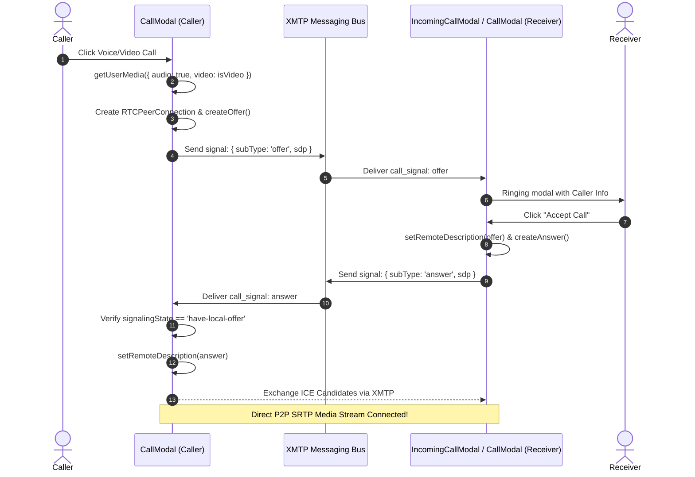

# BlockChat Arcade (BlockChat 2.0) — Architecture & System Specification

> **Decentralized 8-Bit Retro Arcade Messenger with End-to-End Encryption, WebRTC Peer-to-Peer Voice/Video Calling, Playfair Cipher Privacy Screen, and Instant Crypto Tipping.**

---

## Table of Contents
1. [System Overview & Architecture Diagram](#1-system-overview--architecture-diagram)
2. [Technology Stack](#2-technology-stack)
3. [Identity & Blockchain Layer](#3-identity--blockchain-layer)
4. [Transport & Decentralized Messaging Protocol (XMTP v3)](#4-transport--decentralized-messaging-protocol-xmtp-v3)
5. [In-Chat Multiplexed Wire Protocol (`[JSON_MSG]`)](#5-in-chat-multiplexed-wire-protocol-json_msg)
6. [Stealth Privacy Screen: Playfair Cipher Chat Lock](#6-stealth-privacy-screen-playfair-cipher-chat-lock)
7. [Peer-to-Peer WebRTC Audio/Video Calling Pipeline](#7-peer-to-peer-webrtc-audiovideo-calling-pipeline)
8. [Financial Precision & Crypto Transfer Engine](#8-financial-precision--crypto-transfer-engine)
9. [Web Audio Synthesizer & Voice Note Engineering](#9-web-audio-synthesizer--voice-note-engineering)
10. [Gamification & Arcade Progression Engine](#10-gamification--arcade-progression-engine)
11. [Component Tree & Application State Architecture](#11-component-tree--application-state-architecture)
12. [Directory Structure & Module Index](#12-directory-structure--module-index)
13. [Setup, Execution & Environment Guide](#13-setup-execution--environment-guide)

---

## 1. System Overview & Architecture Diagram

BlockChat 2.0 blends the familiar user experience of modern instant messengers (WhatsApp-style receipts, voice waveforms, media attachments, disappearing messages, message reactions) with decentralized Web3 primitives:
- **Zero Central Servers**: Messaging relies on the XMTP (Extensible Message Transport Protocol) decentralized node network.
- **Self-Sovereign Identity**: Accounts are Ethereum wallet keypairs (via EIP-1193 / MetaMask).
- **Dual-Layer Cryptography**: MLS (Messaging Layer Security) end-to-end encryption at the transport level + custom Playfair Cipher chat locks on the application presentation level.
- **Serverless Signaling**: WebRTC audio and video streams establish P2P sessions using XMTP messages as the signaling bus (no Socket.io or custom signaling servers).
- **Non-Custodial Transfers**: Direct wallet-to-wallet ETH tipping and invoice requests with real-time confirmation monitoring.

### System Architecture Diagram

```mermaid
graph TB
    subgraph Client["Client Browser (Next.js 16 + React 19)"]
        UI["Retro Arcade UI / Scanline Effects / Pixel Icons"]
        State["Page State & Stream Coordinators (page.js)"]
        AudioSynth["Web Audio Synthesizer (Oscillators)"]
        PlayfairEngine["Playfair Cipher Engine (5x5 Matrix)"]
        AudioCoord["Single-Track Audio Coordinator"]
        WebRTC["WebRTC PeerConnection (CallModal)"]
    end

    subgraph Identity["Identity & Smart Contracts"]
        EIP1193["MetaMask / Web3 Browser Provider"]
        Registry["UserRegistry Smart Contract (Multi-Chain)"]
    end

    subgraph DecentralizedNet["Decentralized Networks"]
        XMTP["XMTP v3 Network (Wasm Client / MLS)"]
        STUN["Google STUN Servers (ICE Resolution)"]
        EthNet["Ethereum / L2 Chains (Sepolia, Base, Arbitrum)"]
    end

    subgraph PeerClient["Peer Client Browser"]
        PeerUI["Peer BlockChat Client"]
    end

    UI --> State
    State --> PlayfairEngine
    State --> AudioSynth
    State --> AudioCoord
    State --> EIP1193
    EIP1193 --> Registry
    EIP1193 --> EthNet

    State --> XMTP
    XMTP <-->|E2EE Messages & WebRTC Signals| PeerClient
    State --> WebRTC
    WebRTC <-->|STUN Binding| STUN
    WebRTC <===>|Encrypted Media Stream (SRTP)| PeerClient
```

---

## 2. Technology Stack

| Layer | Technologies | Version / Role |
| :--- | :--- | :--- |
| **Framework** | Next.js (App Router), React, React-DOM | Next.js `16.3.2`, React `19.2.8` |
| **Styling & Theme** | Vanilla CSS, PostCSS, TailwindCSS v4 | 8-bit retro arcade design, CRT scanline overlay, pixel grid |
| **Web3 & Provider** | `ethers.js` v6, `viem` | Wallet interaction, BigInt math, contract ABI interaction, ENS |
| **Decentralized Messaging** | `@xmtp/browser-sdk` | v7.1.0 (XMTP v3 MLS client with browser Wasm SQLite backend) |
| **Media & P2P Calling** | WebRTC API, `RTCPeerConnection` | Google STUN servers, decentralized XMTP signaling channel |
| **Offline QR Generation** | `qrcode` | Pure client-side `<canvas>` rendering (no 3rd-party HTTP API) |
| **Icons & Art** | `pixelarticons`, custom SVG pixel glyphs | 24x24 vector arcade icons |
| **Procedural Audio** | HTML5 Web Audio API | Procedural sound generation (square/sine/sawtooth waves) |

---

## 3. Identity & Blockchain Layer

### 3.1 EIP-1193 Provider Integration & Lifecycle
Wallet connectivity is orchestrated through `window.ethereum` wrapped in `ethers.BrowserProvider`:
- **Dynamic Account & Network Synchronization**: Subscribes to `accountsChanged` and `chainChanged` EIP-1193 events. If a user switches wallets in MetaMask, the app automatically drops the stale identity, prompts re-authentication, and avoids signing payloads with an unauthorized address.
- **Chain ID Resolution**: Supports mainnets, testnets, and local sandboxes with automatic contract mapping.

### 3.2 Smart Contract: `UserRegistry`
The application references a deployed `UserRegistry` contract to map wallet addresses to on-chain public profiles:

```solidity
// Contract ABI definition (web/src/app/contracts.js)
function registerUser(string _username, string _profilePictureCID) external;
function updateProfilePicture(string _newCID) external;
function getProfile(address _wallet) external view returns (tuple(string username, string profilePictureCID, bool isRegistered));
function profiles(address) external view returns (string username, string profilePictureCID, bool isRegistered);
function usernameToAddress(string) external view returns (address);
```

#### Multi-Chain Deployment Registry:
```javascript
export const USER_REGISTRY_ADDRESSES = {
  31337: "0x5FbDB2315678afecb367f032d93F642f64180aa3", // Hardhat Localhost
  1337: "0x5FbDB2315678afecb367f032d93F642f64180aa3",  // Ganache
  11155111: "0x5FbDB2315678afecb367f032d93F642f64180aa3", // Sepolia Testnet
  42161: "0x5FbDB2315678afecb367f032d93F642f64180aa3",    // Arbitrum One
  8453: "0x5FbDB2315678afecb367f032d93F642f64180aa3",     // Base Mainnet
  137: "0x5FbDB2315678afecb367f032d93F642f64180aa3"       // Polygon PoS
};
```

### 3.3 Offline Client-Side QR Generation
To prevent address leakages to 3rd-party tracking APIs (`api.qrserver.com`), the app embeds the `qrcode` library to directly render SVG/Canvas elements in [QRCodeModal.js](file:///c:/Users/halda/OneDrive/Desktop/savee/BlockchainApp/web/src/components/QRCodeModal.js) completely client-side without any network requests.

---

## 4. Transport & Decentralized Messaging Protocol (XMTP v3)

### 4.1 Initialization & Wasm Local Storage Security
XMTP v3 requires a persistent encrypted database inside the browser for its local SQLite client state.
- **Key Generation**: Generates a random 32-byte cryptographic key stored in `localStorage` under `xmtp_db_key`.
- **Signer Wrapper**: Converts Ethers v6 signer into the XMTP EIP-712 signer contract:
```javascript
const xmtpSigner = {
  getAddress: async () => signer.address,
  signMessage: async (message) => signer.signMessage(message),
};
const xmtp = await Client.create(xmtpSigner, { 
  env: "dev", 
  dbEncryptionKey: getDbEncryptionKey() 
});
```

### 4.2 Stream Cancellation & Zombie Loop Mitigation
When streaming incoming messages using `conversation.stream()`, switching conversations could cause orphaned async generator loops to pile up in memory. 
BlockChat solves this with an atomic stream sequence reference (`activeStreamIdRef`):
```javascript
// Incremented upon selecting any chat
activeStreamIdRef.current += 1;
const currentStreamId = activeStreamIdRef.current;

const streamMessages = async () => {
  for await (const message of await convo.stream()) {
    // Guard: discard messages from stale stream instances
    if (activeStreamIdRef.current !== currentStreamId) break;
    processIncomingMessage(message);
  }
};
```

### 4.3 Onboarding Pre-flight Check (`canMessage`)
Before initiating a Direct Message conversation, the sender runs `xmtpClient.canMessage([contactIdentifier])`. If the recipient has not yet registered an XMTP identity on the network, the UI informs the user rather than triggering unhandled contract execution exceptions.

---

## 5. In-Chat Multiplexed Wire Protocol (`[JSON_MSG]`)

All rich message types (voice, calls, reactions, crypto payments) are serialized into structured JSON envelopes prefixed with `[JSON_MSG]`. This allows the XMTP text transport to multiplex different payload types seamlessly.

### Wire Format Schema

```typescript
type WirePayload = 
  | { type: 'text'; text: string; replyTo?: ReplyContext }
  | { type: 'voice'; audioData: string; duration: number } // audioData: base64 data-URL
  | { type: 'image'; imageUrl: string; caption?: string }
  | { type: 'crypto_transfer'; amount: string; txHash: string; note: string; status: 'pending' | 'confirmed' }
  | { type: 'payment_request'; amount: string; note: string; status: 'pending' | 'paid'; txHash?: string }
  | { type: 'reaction'; targetMessageId: string; emoji: string; action: 'add' | 'remove' }
  | { type: 'call_signal'; callId: string; subType: 'offer' | 'answer' | 'candidate' | 'reject' | 'end'; sdp?: any; candidate?: any }
  | { type: 'disappearing_config'; timer: number } // timer in seconds (0 = disabled)
  | { type: 'edit_message'; targetMessageId: string; newText: string }
  | { type: 'delete_message'; targetMessageId: string }
```

### 5.1 Cryptographic Message Authorization
For destructive operations (`edit_message`, `delete_message`), the receiving client checks:
```javascript
if (targetMessage.senderInboxId !== incomingMessage.senderInboxId) {
  console.warn("Unauthorized attempt to alter or delete message");
  return;
}
```
This guarantees that malicious peers cannot delete or tamper with messages they did not author.

### 5.2 Deterministic Reaction Matrix
Reactions use a 2D lookup map indexed by `targetMessageId` and `senderInboxId`. The payload carries explicit `action: 'add' | 'remove'`, preventing race conditions and echo toggling when message streams loop back self-sent events.

---

## 6. Stealth Privacy Screen: Playfair Cipher Chat Lock

While XMTP protects messages across the network with MLS encryption, people standing behind you can still read your screen. The **Playfair Cipher Chat Lock** provides a local "privacy screen":

```mermaid
sequenceDiagram
    autonumber
    actor Alice
    participant AppAlice as Alice Client
    participant XMTPNet as XMTP Network
    participant AppBob as Bob Client
    actor Bob

    Note over Alice,Bob: Shared Secret Passkey agreed out-of-band (e.g. "ARCADE")
    Alice->>AppAlice: Set Cipher Key ("ARCADE")
    AppAlice->>AppAlice: Build 5x5 Key Matrix & Hash Fingerprint
    Alice->>AppAlice: Type "MEET AT THE ARCADE"
    AppAlice->>AppAlice: Encrypt to Digraph Envelope: 🔐PF1|f=...;j=...|...
    AppAlice->>XMTPNet: Transmit over XMTP
    XMTPNet->>AppBob: Deliver Envelope
    Note over AppBob: Bob has NOT entered key yet
    AppBob->>Bob: Display Scrambled Text (Derive Screen Key from Hash)
    Bob->>AppBob: Enters Passkey ("ARCADE")
    AppBob->>AppBob: Match SHA-256 Key Fingerprint
    AppBob->>Bob: Decrypt & Render exact plaintext
```

### 6.1 Matrix Construction & Digraph Transformation
- **Alphabet**: 25 uppercase characters (English alphabet with `J` merged into `I`).
- **Matrix**: 5x5 grid seeded with the secret key followed by remaining unused characters.
- **Transformation Rules**:
  - *Same Row*: Shift right (wrap around).
  - *Same Column*: Shift down (wrap around).
  - *Rectangle*: Swap columns while preserving row indices.
  - *Double Letters / Odd Length*: Injected with filler letters `X` or `Q`.

### 6.2 Lossless Envelope Format: `🔐PF1|meta|cipher`
Traditional Playfair ciphers destroy casing, punctuation, spaces, numbers, and lose distinction between `I` and `J`. BlockChat introduces a lossless envelope:
- Only letters are encrypted; spaces, numbers, punctuation, and emojis retain their positions.
- Filler indices (`f=...`) and original `J` positions (`j=...`) are encoded into the envelope header.
- Decryption perfectly restores the original message casing and characters.

### 6.3 Ephemeral Key Lifecycle & Auto-Lock
- **Zero Key Persistence**: The raw key is held **only in volatile memory**; it is never saved to `localStorage` or indexedDB.
- **Fingerprint Verification**: Only a SHA-256 hash of the 5x5 key matrix is saved (`hashPlayfairKey`).
- **Auto-Lock Triggers**:
  - 3 minutes of idle inactivity (`CIPHER_IDLE_LOCK_MS = 180000`).
  - Switching to a different conversation.
  - Page refresh or wallet disconnect.

---

## 7. Peer-to-Peer WebRTC Audio/Video Calling Pipeline

BlockChat implements true peer-to-peer audio and video calls directly inside the browser without third-party signaling servers.



### 7.1 State Machine Guards Against `InvalidStateError`
Because XMTP streams echo messages back to the sender, answering a call could cause the receiver to process its own answer. Calling `pc.setRemoteDescription(answer)` while already in `signalingState = 'stable'` would trigger a WebRTC exception.
BlockChat addresses this with:
1. **Loopback Filter**: Skips any incoming `call_signal` whose `senderInboxId` matches the local client.
2. **State Guard**: Validates `pc.signalingState === 'have-local-offer'` before setting remote answer descriptions.
3. **ICE Candidate Buffer**: Queues remote candidates until `setRemoteDescription` completes.

### 7.2 Autoplay & Video Pipeline Architecture
- **Dedicated Audio**: Remote audio is routed through a dedicated hidden `<audio ref={remoteAudioRef} autoPlay playsInline />` element, preventing video tag muting from muting incoming audio.
- **Hardware Decoding Compliance**: Remote `<video>` elements remain mounted with opacity transitions (`opacity: hasRemoteVideo ? 1 : 0`), preventing Chromium/WebKit engines from discarding video decoders.

---

## 8. Financial Precision & Crypto Transfer Engine

### 8.1 Safe Financial Arithmetic (No Floating-Point Precision Loss)
Using native JavaScript `Number` or `parseFloat` can result in exponential notation (e.g., `1e-7`) or rounding errors. BlockChat strictly uses `ethers.parseEther` and BigInt primitives:
```javascript
const weiAmount = ethers.parseEther(trimmedAmt);
// Dynamic gas buffer verification against user balance
const userWei = ethers.parseEther(userBalance.toString());
if (weiAmount >= userWei) {
  throw new Error("Insufficient balance to cover transfer amount + gas fee buffer");
}
```

### 8.2 Asynchronous Transaction Confirmation Pipeline
1. **Broadcast Hash**: When the user approves in MetaMask, `tx.hash` is immediately posted as an optimistic `status: 'pending'` message in chat.
2. **Background Confirmation**: An asynchronous observer `tx.wait(1)` monitors the blockchain. Once mined, it emits `status: 'confirmed'`.
3. **Multi-Chain Explorer Resolution**: Transaction receipts generate links dynamically according to EIP-155 Chain IDs (Etherscan, Arbiscan, Basescan, Polygonscan).

---

## 9. Web Audio Synthesizer & Voice Note Engineering

### 9.1 Procedural 8-Bit Audio Synthesizer
Rather than loading static MP3 assets, BlockChat includes a built-in procedural synthesizer powered by the browser's `AudioContext`:
- **Send Boop**: High-to-low pitch frequency sweep on a square wave.
- **Receive Blip**: Rapid two-tone ascending chime.
- **Coin Burst**: Ascending arpeggio (B5 $\rightarrow$ E6) mimicking vintage coin insertion.
- **Phone Ring**: Dual-tone multifrequency (DTMF) 440 Hz + 480 Hz cadence with exponential gain ramp.

### 9.2 Voice Note Recording & Playback Coordinator
- **MediaRecorder Capture**: Encodes mic audio into `audio/webm` or `audio/ogg` Base64 data URLs.
- **Single-Track Audio Coordinator**: Dispatches a `blockchat:audio-play` window event whenever any audio player begins, cleanly pausing any other playing voice note.
- **Non-Destructive Speed Switching**: Decouples audio instance lifecycle from playback speed changes. Toggling between `1x`, `1.5x`, and `2x` mutates `audio.playbackRate` directly without resetting `currentTime` to zero.
- **Waveform Scrubbing**: Clicking anywhere on the waveform maps coordinates to playback time:
  $$\text{currentTime} = \frac{\text{clickX}}{\text{totalWidth}} \times \text{duration}$$

---

## 10. Gamification & Arcade Progression Engine

BlockChat incorporates a retro arcade XP progression engine ([arcadeXp.js](file:///c:/Users/halda/OneDrive/Desktop/savee/BlockchainApp/web/src/utils/arcadeXp.js)):

| Level | Title | Min XP | Max XP | Badge | Theme Color |
| :---: | :--- | :---: | :---: | :---: | :---: |
| **1** | **ROOKIE 1P** | 0 | 100 | 🪙 | `#ffd166` |
| **2** | **CYPHERPUNK** | 100 | 250 | ⚡ | `#39ff14` |
| **3** | **NETRUNNER** | 250 | 500 | 👾 | `#00f0ff` |
| **4** | **HIGH ROLLER**| 500 | 1000 | 💎 | `#ff007f` |
| **5** | **BLOCK MASTER**| 1000 | 2000 | 👑 | `#ffd166` |
| **6** | **ARCADE LEGEND**| 2000 | 99999 | 🏆 | `#39ff14` |

### Progression Triggers:
- **Wallet Connection**: `+50 XP`
- **Sending Chat Message**: `+5 XP`
- **ETH Crypto Tip**: `+25 XP` + triggers `<PixelCoinBurst />` particle explosion
- **Setting Cipher Lock**: `+15 XP`
- **Level-Up Celebrations**: Displays `<LevelUpToast />` overlay accompanied by a celebratory synthesizer sound.

---

## 11. Component Tree & Application State Architecture

```mermaid
graph TD
    App["app/page.js (Main Orchestrator & State Hub)"]

    App --> Hero["HeroDashboard.js (Welcome & Quick Stats)"]
    App --> ChatArea["Chat Window & Message History"]
    App --> Composer["Input Composer & Attachment Bar"]

    App --> Drawer["ContactInfoDrawer.js (Media Gallery & Settings)"]
    App --> CallModal["CallModal.js (WebRTC Audio/Video)"]
    App --> IncCall["IncomingCallModal.js (Incoming Ringing)"]
    App --> SendCrypto["SendCryptoModal.js (ETH Transfers & Requests)"]
    App --> QRModal["QRCodeModal.js (Offline Address QR)"]
    App --> Profile["ProfileModal.js (ENS / On-Chain Profile)"]
    App --> CipherModal["PlayfairLockModal.js (Stealth Key Matrix)"]
    App --> ThemeModal["CoffeeThemeModal.js (Palette Customizer)"]
    App --> LevelUp["LevelUpToast.js & PixelCoinBurst.js"]

    ChatArea --> VoicePlayer["VoiceNotePlayer.js (Waveform Scrubbing)"]
    ChatArea --> Receipt["CryptoReceipt.js (Arcade ETH Ledger)"]
    Composer --> Emoji["EmojiPicker.js (250+ Emojis & Search)"]
```



### Core State Hub (`page.js`)
- `account`, `chainId`, `signer`, `userBalance`: Active Web3 wallet session.
- `xmtpClient`, `conversations`, `selectedConvo`: Active messaging session.
- `messages`: Chronological list of parsed messages for the active conversation.
- `cipherKeys`: Ephemeral dictionary mapping `conversationId` to unlocked Playfair keys in memory.
- `starredMessages`: Persisted starred items.
- `customNicknames`: Local address-book aliases for wallet addresses.
- `arcadeXp`: Player XP stored in `localStorage`.

---

## 12. Directory Structure & Module Index

```
BlockchainApp/
├── README.md                      # High-level product summary
├── IMPROVEMENTS.md                # Detailed non-UI architectural improvements
├── ARCHITECTURE.md                # This comprehensive architecture document
└── web/                           # Next.js web application
    ├── package.json               # Dependencies & build scripts
    ├── next.config.mjs            # Next.js bundler config
    └── src/
        ├── app/
            ├── layout.js          # Root layout, arcade fonts & metadata
            ├── page.js            # Main controller, state management, XMTP streams
            ├── globals.css        # Arcade design system, CRT scanlines, themes
            └── contracts.js       # UserRegistry ABI & multi-chain address map
        ├── components/
            ├── CallModal.js               # WebRTC P2P Voice/Video call engine
            ├── IncomingCallModal.js       # Ringing incoming call dialog
            ├── ContactInfoDrawer.js       # Sliding drawer (media, notes, starred)
            ├── CryptoReceipt.js           # Arcade-style crypto transfer receipt
            ├── SendCryptoModal.js         # ETH tipping & payment request dialog
            ├── PlayfairLockModal.js       # Playfair Cipher key matrix modal
            ├── VoiceNotePlayer.js         # Audio player with waveform scrubbing
            ├── EmojiPicker.js             # 250+ emoji catalog with real-time search
            ├── HeroDashboard.js           # Retro welcome screen with hi-score board
            ├── PixelIcons.js              # 24x24 SVG pixel icon collection
            ├── PixelCoinBurst.js          # Particle physics coin explosion animation
            ├── LevelUpToast.js            # Arcade rank progression notification
            ├── ProfileModal.js            # User profile & avatar editor
            ├── QRCodeModal.js             # Offline client-side QR generator
            └── CoffeeThemeModal.js        # Warm coffee arcade palette switcher
        └── utils/
            ├── playfairCipher.js          # 5x5 matrix encryption & lossless envelope
            ├── arcadeXp.js                # XP progression engine & rank definitions
            └── whatsappMarkdown.js        # Formatting parser (*bold*, `code`, URLs)
```

---

## 13. Setup, Execution & Environment Guide

### Prerequisites
- **Node.js**: `v18.0.0` or higher (compatible with Next.js 16 and React 19).
- **Web3 Wallet**: MetaMask, Coinbase Wallet, or any EIP-1193 compatible browser extension.

### Running Locally
```bash
# 1. Navigate to the web frontend
cd web

# 2. Install dependencies
npm install

# 3. Launch development server with Turbopack
npm run dev
```

Visit [http://localhost:3000](http://localhost:3000) in your browser.

### Solo Testing Mode (No Second Device Required)
When testing alone, BlockChat includes a built-in companion: **BlockBot** (`0x000000000000000000000000000000000000dead`):
- Connect wallet and click the demo BlockBot chat.
- Test sending text, emojis, voice notes, and simulated ETH tips.
- Test WebRTC calls: BlockBot will simulate picking up the call after 2.2 seconds to verify your local camera, microphone, and audio loopback.
- Test Playfair cipher encryption: Set a cipher key and see BlockBot respond with Playfair-encrypted messages that decrypt in real time.
