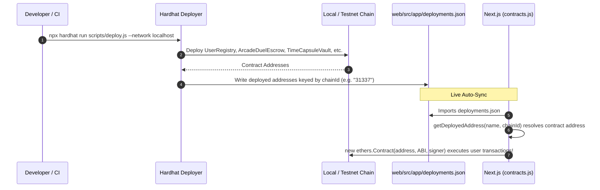

# 👾 BlockChat Arcade — Comprehensive Architecture & Smart Contract Guide

> **An in-depth guide covering how the entire project works, its architectural subsystems, directory layout, and complete smart contract mechanics.**

---

## Table of Contents
1. [Executive Summary & Core Concept](#1-executive-summary--core-concept)
2. [High-Level Architecture & Data Flow](#2-high-level-architecture--data-flow)
3. [Repository Directory Structure](#3-repository-directory-structure)
4. [Subsystem Deep Dives: How the Frontend & Protocol Work](#4-subsystem-deep-dives-how-the-frontend--protocol-work)
   - [4.1 Identity, Wallets & ENS](#41-identity-wallets--ens)
   - [4.2 Decentralized Transport (XMTP v3 MLS)](#42-decentralized-transport-xmtp-v3-mls)
   - [4.3 In-Chat Multiplexed Envelope Protocol (`[JSON_MSG]`)](#43-in-chat-multiplexed-envelope-protocol-json_msg)
   - [4.4 Shoulder-Surfing Defense: Playfair Cipher Chat Lock](#44-shoulder-surfing-defense-playfair-cipher-chat-lock)
   - [4.5 Serverless WebRTC Audio & Video Calling](#45-serverless-webrtc-audio--video-calling)
   - [4.6 Procedural 8-Bit Web Audio Synthesizer](#46-procedural-8-bit-web-audio-synthesizer)
   - [4.7 Copilot Engine & Slash Command Terminal](#47-copilot-engine--slash-command-terminal)
   - [4.8 Multiplayer Arcade Party Lobby](#48-multiplayer-arcade-party-lobby)
   - [4.9 Gamification & Arcade XP System](#49-gamification--arcade-xp-system)
5. [Smart Contracts Architecture & Mechanics](#5-smart-contracts-architecture--mechanics)
   - [5.1 UserRegistry.sol (Peer Identity & ENS Profiles)](#51-userregistrysol-peer-identity--ens-profiles)
   - [5.2 ArcadeDuelEscrow.sol (Commit-Reveal 1v1 RPS Escrow)](#52-arcadeduelescrowsol-commit-reveal-1v1-rps-escrow)
   - [5.3 TimeCapsuleVault.sol (Timelocked On-Chain Capsules)](#53-timecapsulevaultsol-timelocked-on-chain-capsules)
   - [5.4 GiftPacketVault.sol (Provably Fair Red Envelopes)](#54-giftpacketvaultsol-provably-fair-red-envelopes)
   - [5.5 InvoiceManager.sol (Payment Requests & Split Bills)](#55-invoicemanagersol-payment-requests--split-bills)
   - [5.6 PollRegistry.sol (Transparent On-Chain Voting)](#56-pollregistrysol-transparent-on-chain-voting)
6. [Contract Deployment & Frontend Binding Pipeline](#6-contract-deployment--frontend-binding-pipeline)
7. [Testing, Compilation & Local Execution Workflow](#7-testing-compilation--local-execution-workflow)

---

## 1. Executive Summary & Core Concept

**BlockChat Arcade** is a decentralized, wallet-to-wallet Web3 communication platform built with **Next.js 16**, **React 19**, **XMTP v3**, **Ethers.js v6**, and **Solidity (0.8.24)**.

Traditional messengers (WhatsApp, Telegram, Discord) rely on centralized database clusters that track user identity, phone numbers, contact graphs, and message metadata. BlockChat Arcade takes an entirely decentralized, peer-to-peer approach wrapped in an **8-bit retro arcade aesthetic**:

1. **Zero Central Servers**: Messaging is transported across the decentralized **XMTP (Extensible Message Transport Protocol)** node network using Messaging Layer Security (MLS) end-to-end encryption.
2. **Cryptographic Identity**: Accounts are Ethereum wallet addresses (`0x...`) authenticated via EIP-1193 (MetaMask, Coinbase Wallet, etc.) and resolved to human-readable names via **ENS** or the on-chain **UserRegistry**.
3. **Conversational Decentralized Finance (DeFi)**: In-chat ETH tipping, invoice billing, bill splitting, and red-envelope gift drops happen directly within conversation threads.
4. **Gamified Interaction**: Wagered commit-reveal Rock-Paper-Scissors duels, timelocked secret capsules, live on-chain polls, and retro XP progression make chat an interactive game.
5. **Two-Layer Privacy Protection**: Transport layer security (XMTP MLS) protects messages across the wire, while a local presentation-layer **Playfair 5×5 Cipher** protects messages from physical shoulder-surfers.

---

## 2. High-Level Architecture & Data Flow

```mermaid
graph TB
    subgraph Browser["Client Browser (Next.js 16 + React 19)"]
        UI["Retro Arcade UI & CRT Scanline Shader"]
        Page["Central Orchestrator (page.js)"]
        Playfair["Playfair 5x5 Cipher Engine"]
        Synth["Web Audio 8-Bit Chiptune Synthesizer"]
        RTC["WebRTC RTCPeerConnection (Media Streams)"]
        Copilot["Copilot Slash Command Dispatcher"]
    end

    subgraph WalletLayer["Identity & EVM Wallet"]
        MetaMask["MetaMask / EIP-1193 Provider"]
        Signer["Ethers v6 Signer & Provider"]
    end

    subgraph EVM["EVM Blockchain (Localhost / Sepolia / L2s)"]
        UR["UserRegistry.sol"]
        ADE["ArcadeDuelEscrow.sol"]
        TCV["TimeCapsuleVault.sol"]
        GPV["GiftPacketVault.sol"]
        IM["InvoiceManager.sol"]
        PR["PollRegistry.sol"]
    end

    subgraph DecentralizedTransport["Decentralized Messaging (XMTP v3)"]
        MLS["MLS End-to-End Encryption"]
        WasmDB["Browser Wasm SQLite Client DB"]
        Nodes["XMTP Decentralized Node Network"]
    end

    subgraph PeerClient["Remote Peer Browser"]
        PeerUI["Peer BlockChat Arcade Client"]
    end

    UI --> Page
    Page --> Copilot
    Page --> Playfair
    Page --> Synth
    Page --> RTC

    Page --> MetaMask
    MetaMask --> Signer
    Signer -->|Transactions & Views| UR
    Signer -->|Lock Stake & Reveal| ADE
    Signer -->|Lock ETH & Secret| TCV
    Signer -->|Fund & Claim Packets| GPV
    Signer -->|Pay & Settle Bills| IM
    Signer -->|Cast On-Chain Votes| PR

    Page --> WasmDB
    WasmDB --> MLS
    MLS <-->|Encrypted Packets & Signaling| Nodes
    Nodes <-->|XMTP Wire Bus| PeerClient
    RTC <===>|Direct SRTP Audio/Video (STUN)| PeerClient
```

---

## 3. Repository Directory Structure

```
blockchain/
├── contracts/                        # Core Solidity Smart Contracts (v0.8.24)
│   ├── ArcadeDuelEscrow.sol         # Trustless 1v1 commit-reveal RPS duel escrow
│   ├── GiftPacketVault.sol          # Provably fair multi-slot ETH red packets
│   ├── InvoiceManager.sol           # 1-to-1 payment requests & 1-to-N bill splitting
│   ├── PollRegistry.sol             # On-chain transparent voting & ballot registry
│   ├── TimeCapsuleVault.sol         # Timelocked message + ETH digital vaults
│   └── UserRegistry.sol             # Username & IPFS avatar identity registry
├── scripts/
│   └── deploy.js                    # Multi-chain deployment script (exports to deployments.json)
├── test/                            # Hardhat unit tests (43 test specs)
│   ├── ArcadeDuelEscrow.test.js     # 9 tests: commit, reveal, timeout, draw, cancel
│   ├── GiftPacketVault.test.js      # 8 tests: slot math, claims, expiry, refund
│   ├── InvoiceManager.test.js       # 8 tests: single invoice, split bills, cancel
│   ├── PollRegistry.test.js         # 7 tests: options, vote flipping, early close
│   ├── TimeCapsuleVault.test.js     # 6 tests: timelock, payload secrecy, withdrawal
│   └── UserRegistry.test.js         # 5 tests: lowercase normalization, avatars, lookup
├── hardhat.config.js                # Hardhat environment config (Solidity 0.8.24, Paris EVM)
├── package.json                     # Root contract tooling (Hardhat, Toolbox, OpenZeppelin)
├── ARCHITECTURE.md                  # Detailed frontend/XMTP/WebRTC specification
├── PROJECT_OVERVIEW.md              # Feature list & product overview
├── HANDOVER.md                      # Feature implementation notes & game fix logs
└── web/                             # Next.js 16 Web Application
    ├── package.json                 # Web dependencies (@xmtp/browser-sdk, ethers, pixelarticons)
    ├── next.config.mjs              # Next.js configuration
    ├── public/                      # Static assets, SVG icons, PWA manifest, service worker
    │   ├── icon.svg                 # 8-bit retro arcade app icon
    │   ├── manifest.webmanifest     # Progressive Web App manifest
    │   └── sw.js                    # Service worker for background notifications
    └── src/
        ├── app/
        │   ├── layout.js            # Root HTML layout, font setup, CSS imports
        │   ├── page.js              # Central orchestrator: state, XMTP loop, UI trees
        │   ├── contracts.js         # ABIs, address resolvers, and deployments.json binding
        │   ├── deployments.json     # Auto-generated contract addresses by chain ID
        │   ├── globals.css          # Design system, CRT scanline overlay, theme variables
        │   ├── features.css         # Styling for cards, modals, and copilot widgets
        │   └── arcade-polish.css    # Retro badges, pixel borders, audio controls
        ├── components/              # Modular UI components
        │   ├── ArcadeDuelCard.js    # Interactive 1v1 Rock-Paper-Scissors card
        │   ├── CallModal.js         # WebRTC voice/video active calling interface
        │   ├── CoffeeThemeModal.js  # Theme picker (Arcade Neon, Gameboy, Cyberpunk, Coffee)
        │   ├── ContactInfoDrawer.js # Chat metadata, media vault, starred messages
        │   ├── CopilotPalette.js    # Floating autocomplete command palette
        │   ├── CopilotWidgetCard.js # In-chat response cards for /price, /gas, /trivia
        │   ├── CreateGroupModal.js  # Group creation & party room setup
        │   ├── CryptoReceipt.js     # Block explorer receipt card for ETH tips
        │   ├── EmojiPicker.js       # Searchable pixel emoji selector
        │   ├── GiftPacketCard.js    # Interactive red packet claim card
        │   ├── GroupMembersModal.js # Lobby participant list & status
        │   ├── HeroDashboard.js     # Retro welcome dashboard & quick launch stats
        │   ├── IncomingCallModal.js # Ringing incoming call modal with audio alert
        │   ├── LevelUpToast.js      # Animated XP rank advancement banner
        │   ├── PixelCoinBurst.js    # Canvas physics particle explosion on ETH tip
        │   ├── PixelIcons.js        # 24x24 retro SVG pixel art icon library
        │   ├── PlayfairLockModal.js # 5x5 key matrix input & cipher configuration
        │   ├── PollCard.js          # Live voting poll card with dynamic progress bars
        │   ├── ProfileModal.js      # On-chain profile editor (username, avatar CID)
        │   ├── QRCodeModal.js       # Client-side offline QR code generator
        │   ├── SendCryptoModal.js   # ETH tipping, payment request, & bill split modal
        │   ├── TimeCapsuleCard.js   # Sealed digital capsule countdown card
        │   ├── TimeCapsuleModal.js  # Capsule creation modal (duration, ETH, secret)
        │   └── VoiceNotePlayer.js   # Waveform audio player with scrub & speed controls
        └── utils/                   # Pure utility functions and engines
            ├── arcadeXp.js          # XP progression math, level ranks, badge metadata
            ├── copilotEngine.js     # Command parser for /gas, /price, /flip, /roll, etc.
            ├── interactions.js      # State aggregation for polls, gifts, and duel updates
            ├── playfairCipher.js    # 5x5 Polybius matrix cipher & lossless envelope encoder
            └── whatsappMarkdown.js  # Text formatter for *bold*, _italic_, ~strike~, `code`
```

---

## 4. Subsystem Deep Dives: How the Frontend & Protocol Work

### 4.1 Identity, Wallets & ENS
- **Connection**: `page.js` utilizes `window.ethereum` via Ethers.js `BrowserProvider`.
- **Reactivity**: Listens for `accountsChanged` and `chainChanged` events. When the user switches accounts in MetaMask, stale identities are purged, XMTP re-authenticates with the new address, and balance monitors reset.
- **ENS Resolution**: The app automatically executes `provider.lookupAddress(account)` to resolve Ethereum addresses into names (e.g. `alice.eth`).
- **On-Chain Profiles**: When an address is viewed, `UserRegistry.getProfile(address)` fetches custom usernames and IPFS/URL avatar CIDs.

### 4.2 Decentralized Transport (XMTP v3 MLS)
- **Local SQLite Engine**: XMTP v3 runs a compiled WebAssembly SQLite database in the browser to store cryptographic state. The encryption key is randomly generated upon first setup and held in browser storage.
- **Signer Binding**: Converts an Ethers v6 signer into an EIP-712 XMTP signer:
  ```javascript
  const xmtpSigner = {
    getAddress: async () => signer.address,
    signMessage: async (message) => signer.signMessage(message),
  };
  const xmtpClient = await Client.create(xmtpSigner, {
    env: "dev",
    dbEncryptionKey: getDbEncryptionKey(),
  });
  ```
- **Zombie Stream Prevention**: When switching conversations, previous streaming loops could linger and duplicate messages. BlockChat uses an atomic reference counter (`activeStreamIdRef.current += 1`). If a stream callback notices its ID is no longer the active conversation, it gracefully terminates.
- **Onboarding Check**: Before opening a new DM, `xmtpClient.canMessage([address])` checks whether the target wallet has activated an XMTP identity.

### 4.3 In-Chat Multiplexed Envelope Protocol (`[JSON_MSG]`)
Because XMTP is natively a text transport, rich media, WebRTC signals, and on-chain cards are transmitted as structured JSON payloads prefixed with `[JSON_MSG]`:

```json
{
  "type": "duel",
  "action": "challenge",
  "duelId": 42,
  "wager": "0.01",
  "challenger": "0x123...",
  "opponent": "0x456...",
  "txHash": "0xabc..."
}
```

The receiver's message parser detects the `[JSON_MSG]` tag, parses the payload, and renders the corresponding component:
- `text`: Standard message (supports markdown, quoted replies).
- `voice`: MediaRecorder base64 audio data URL with waveform scrub support.
- `crypto_transfer`: ETH tip receipt card with live etherscan link.
- `crypto_request`: Split bill or payment invoice card with direct "Pay Now" action.
- `call_signal`: WebRTC signaling message (offer, answer, candidate, reject, end).
- `interaction`: Lightweight state update for poll votes or gift packet claims.
- `duel`: On-chain commit-reveal RPS challenge, response, or settlement card.
- `capsule`: On-chain timelocked vault card.
- `disappearing_config`: Chat autodestruct timer configuration.

### 4.4 Shoulder-Surfing Defense: Playfair Cipher Chat Lock
Transport encryption ensures miners and eavesdroppers cannot read your messages, but anyone standing behind you could read your screen.
1. **5×5 Polybius Matrix**: Keyphrase builds a 25-character grid (`I` and `J` share one cell).
2. **Lossless Envelope (`🔐PF1|...`)**: Standard Playfair ciphers destroy spaces, numbers, punctuation, and uppercase/lowercase casing. BlockChat’s `playfairCipher.js` encodes metadata headers (`f=` filler indices, `j=` J-character positions) so decryption perfectly restores the original message.
3. **Zero Raw Key Storage**: The encryption key lives **only in volatile React state**. It is never written to `localStorage`.
4. **Auto-Lock**: A 3-minute inactivity timer (`CIPHER_IDLE_LOCK_MS = 180000`) or switching conversations immediately wipes the key from memory.

### 4.5 Serverless WebRTC Audio & Video Calling
Traditional WebRTC requires a central WebSockets or Socket.io signaling server. BlockChat uses **XMTP itself as the signaling channel**:
1. Alice initiates a call $\rightarrow$ `CallModal.js` captures `getUserMedia()`, creates an `RTCPeerConnection`, generates an SDP Offer, and transmits it via an XMTP `call_signal` envelope.
2. Bob’s client receives the offer $\rightarrow$ launches `IncomingCallModal.js` with an 8-bit procedural phone ring sound.
3. Bob clicks **Accept** $\rightarrow$ generates an SDP Answer and sends it back over XMTP.
4. ICE Candidates are exchanged over XMTP using Google STUN servers.
5. Media stream connects directly P2P via encrypted SRTP.
6. **Defensive WebRTC State Machine**: Loopback suppression ignores self-emitted signals, and an ICE candidate queue prevents `InvalidStateError` exceptions before `setRemoteDescription` finishes.

### 4.6 Procedural 8-Bit Web Audio Synthesizer
BlockChat uses the browser's `AudioContext` to synthesize authentic arcade sound effects on the fly without downloading any audio files:
- **Send Sound**: High-to-low square wave pitch sweep.
- **Receive Sound**: Ascending two-tone arpeggio chime.
- **Coin Burst**: Vintage B5 $\rightarrow$ E6 frequency leap triggered when sending or receiving ETH tips.
- **Level Up Fanfare**: Multi-stage celebratory chiptune melodic sequence.
- **Phone Ring**: DTMF-style dual-oscillator frequency modulation (440 Hz + 480 Hz).

### 4.7 Copilot Engine & Slash Command Terminal
Typing `/` into the chat input summons the **Copilot Palette** (`CopilotPalette.js`), powered by `copilotEngine.js`:
- `/gas`: Fetches live Ethereum gas prices (Safe, Standard, Fast).
- `/price [symbol]`: Queries live crypto prices for ETH, BTC, SOL.
- `/duel [wager]`: Spawns an on-chain 1v1 RPS commit-reveal challenge.
- `/capsule [minutes] [eth] [message]`: Seals an on-chain timelocked vault.
- `/gift [eth] [slots] [note]`: Drops an on-chain multi-slot red packet.
- `/poll [question] | [opt1] | [opt2]`: Launches an on-chain live poll.
- `/split [eth] [people] [note]`: Spawns a split-bill invoice.
- `/flip`, `/roll`, `/trivia`: Instant retro arcade mini-games.
- `/export [json|txt]`: Downloads complete conversation logs directly to disk.
- `/notify`: Requests browser Notification permissions for desktop background alerts.

### 4.8 Multiplayer Arcade Party Lobby
Clicking the retro alien icon in the sidebar or typing `/lobby` opens the **Arcade Party Lobby**:
- Simulates an active multi-member squad (`You`, `BlockBot AI 🤖`, `CypherPunk #42`, `PixelKnight 🛡️`).
- Features arcade sender badges with distinct neon color themes (`.peer-knight`, `.peer-cypher`, `.peer-bot`).
- Automated banter, real-time poll voting participation, and competitive gift packet claiming simulate a bustling multiplayer chat environment.

### 4.9 Gamification & Arcade XP System
`arcadeXp.js` calculates player rank based on on-chain and chat activity:
- **Ranks**: Rookie 1P (Level 1) $\rightarrow$ Cypherpunk (Level 2) $\rightarrow$ Netrunner (Level 3) $\rightarrow$ High Roller (Level 4) $\rightarrow$ Block Master (Level 5) $\rightarrow$ Arcade Legend (Level 6).
- **XP Triggers**: Connecting wallet (+50 XP), sending messages (+5 XP), setting cipher locks (+15 XP), and tipping ETH (+25 XP).
- **Visual Rewards**: Triggers `<PixelCoinBurst />` (physics-based coin particles) and `<LevelUpToast />` when leveling up.

---

## 5. Smart Contracts Architecture & Mechanics

All smart contracts are written in Solidity `^0.8.24` and utilize OpenZeppelin `ReentrancyGuard` for strict exploit prevention.

```mermaid
classDiagram
    class UserRegistry {
        +mapping profiles
        +registerUser(username, cid)
        +updateProfilePicture(newCID)
        +getProfile(wallet)
        +usernameToAddress(username)
    }

    class ArcadeDuelEscrow {
        +mapping duels
        +createDuel(commitHash) uint256
        +respondDuel(duelId, opponentMove)
        +revealAndSettle(duelId, challengerMove, salt)
        +claimTimeout(duelId)
        +cancelDuel(duelId)
    }

    class TimeCapsuleVault {
        +mapping capsules
        +createCapsule(recipient, unlockTime, title, payload) uint256
        +open(capsuleId) string
        +getPayload(capsuleId) string
        +getCapsule(capsuleId)
    }

    class GiftPacketVault {
        +mapping packets
        +createPacket(slots, expiresAt, message) uint256
        +claimPacket(packetId) uint256
        +refundExpired(packetId)
        +prizeAt(packetId, index) uint256
    }

    class InvoiceManager {
        +mapping invoices
        +createInvoice(payer, amount, maxPayers, note) uint256
        +payInvoice(invoiceId)
        +cancelInvoice(invoiceId)
        +getInvoice(invoiceId)
    }

    class PollRegistry {
        +mapping polls
        +createPoll(question, options, closesAt) uint256
        +vote(pollId, option)
        +closePoll(pollId)
        +getPoll(pollId)
        +voteOf(pollId, account)
    }
```



---

### 5.1 UserRegistry.sol (Peer Identity & ENS Profiles)
[UserRegistry.sol](file:///s:/blockchain/contracts/UserRegistry.sol) serves as the decentralized identity registry mapping Ethereum addresses to permanent usernames and IPFS/URL avatar CIDs.

#### Key Mechanics:
1. **Permanent Unique Username**:
   - Each wallet address can register once (`AlreadyRegistered` error).
   - Validates length between 3 and 20 characters matching `[a-zA-Z0-9_]`.
   - Normalizes usernames to lowercase bytes before computing `keccak256(_lower(username))` to guarantee case-insensitive uniqueness (`alice` and `ALICE` cannot co-exist).
2. **Updatable Profile Picture**:
   - Registered users can update their profile picture CID or URL at any time via `updateProfilePicture(string _newCID)` (max 256 bytes).
3. **Safe Fallback**:
   - Includes an empty `fallback()` function to absorb wallet introspection probes (such as MetaMask token detection) without reverting.

---

### 5.2 ArcadeDuelEscrow.sol (Commit-Reveal 1v1 RPS Escrow)
[ArcadeDuelEscrow.sol](file:///s:/blockchain/contracts/ArcadeDuelEscrow.sol) implements a wagered, trustless Rock-Paper-Scissors duel between two wallets.

#### Why Commit-Reveal is Required:
In a public blockchain, all transactions are visible in the mempool before confirmation. If Challenger played "Rock" in plaintext, Opponent could inspect the transaction and front-run with "Paper".

#### The 3-Step Protocol:
1. **Commitment (`createDuel`)**:
   - Challenger selects a secret move (`1 = ROCK`, `2 = PAPER`, `3 = SCISSORS`) and generates a cryptographically random secret string (`salt`).
   - Challenger hashes them locally:
     $$\text{commitHash} = \text{keccak256}(\text{uint8}(\text{move}) + \text{":"} + \text{salt})$$
   - Challenger submits `commitHash` alongside their ETH wager to `createDuel()`. The move remains mathematically hidden.
2. **Response (`respondDuel`)**:
   - Opponent accepts by submitting their move in plaintext (`opponentMove`) and matching the exact ETH wager (`msg.value == d.wager`).
   - The contract locks both wagers ($2 \times \text{wager}$) and starts a **15-minute countdown** (`revealDeadline = block.timestamp + 15 minutes`).
3. **Reveal & Settlement (`revealAndSettle`)**:
   - Challenger submits their plaintext move and salt.
   - The contract validates:
     $$\text{keccak256}(\text{uint8}(\text{challengerMove}) + \text{":"} + \text{salt}) == \text{d.commitHash}$$
   - If valid, the contract computes the winner:
     - **Challenger wins**: $2 \times \text{wager}$ paid to Challenger.
     - **Opponent wins**: $2 \times \text{wager}$ paid to Opponent.
     - **Draw**: $1 \times \text{wager}$ refunded back to both players.

#### Anti-Cheat & Timeout Protections:
- **Abandonment Forfeiture (`claimTimeout`)**: If Challenger sees Opponent's move and refuses to reveal (hoping to lock up Opponent's money), Opponent can call `claimTimeout()` after 15 minutes to automatically claim the entire pot.
- **Cancellation (`cancelDuel`)**: If Challenger creates a duel that no one accepts, Challenger can withdraw their wager after 1 hour.

---

### 5.3 TimeCapsuleVault.sol (Timelocked On-Chain Capsules)
[TimeCapsuleVault.sol](file:///s:/blockchain/contracts/TimeCapsuleVault.sol) allows users to seal a secret text payload and an optional ETH balance in an on-chain vault that **cannot be opened by anyone until a specific timestamp passes**.

#### Key Mechanics:
1. **Creation (`createCapsule`)**:
   - Specifies `recipient`, `unlockTime` (must be in the future), `title`, and `payload` with optional attached `msg.value`.
2. **Strict Time Lock (`open`)**:
   - The contract requires `block.timestamp >= unlockTime`. Early attempts revert with `StillLocked(unlockTime)`.
   - Only the designated `recipient` can call `open()`.
   - Upon unlocking, the stored ETH is forwarded to the recipient, and the `CapsuleOpened` event emits the payload.
3. **Payload Gating (`getPayload`)**:
   - Even view functions enforce access: only the `sender` or `recipient` can read the payload via `getPayload()`, and only after `unlockTime` has elapsed.

---

### 5.4 GiftPacketVault.sol (Provably Fair Red Envelopes)
[GiftPacketVault.sol](file:///s:/blockchain/contracts/GiftPacketVault.sol) implements digital "Red Packets" (lucky money drops) for group chats and peer channels.

#### Key Mechanics:
1. **Creation (`createPacket`)**:
   - Creator deposits ETH and specifies `slots` (max 50) and an `expiresAt` timestamp (e.g. 24 hours).
2. **Provably Fair Weighted Split Algorithm**:
   - Rather than relying on easily manipulated block timestamps or miners, prize sizes are derived deterministically from the `packetId` and slot index $i$:
     $$\text{weight}(i) = (\text{uint256}(\text{keccak256}(\text{abi.encodePacked}(\text{packetId}, i))) \pmod{100}) + 1$$
     $$\text{prize}(i) = \frac{\text{total} \times \text{weight}(i)}{\sum_{k=0}^{\text{slots}-1} \text{weight}(k)}$$
   - Anyone can call `prizeAt(packetId, index)` to preview slot prizes beforehand.
   - **Dust Sweeping**: The final slot ($i = \text{slots} - 1$) receives `total - claimedAmount`, guaranteeing $100\%$ of the deposited ETH is paid out with zero rounding loss.
   - Every slot is guaranteed to receive at least 1 wei (`MIN_WEI_PER_SLOT = 100`).
3. **Fair Claiming Rules**:
   - Each wallet address can claim at most one slot (`claimed[packetId][msg.sender]`).
   - The creator cannot claim their own packet (`CreatorCannotClaim`).
4. **Creator Expiration Refund (`refundExpired`)**:
   - If slots remain unclaimed after `expiresAt`, the creator can call `refundExpired()` to retrieve all leftover ETH.

---

### 5.5 InvoiceManager.sol (Payment Requests & Split Bills)
[InvoiceManager.sol](file:///s:/blockchain/contracts/InvoiceManager.sol) provides trustless, non-custodial crypto payment requests and split-bill coordination.

#### Key Mechanics:
1. **Zero-Custody Forwarding**:
   - The contract **never holds user funds**. When a payer calls `payInvoice{value: amount}()`, the contract immediately forwards the ETH directly to the creator:
     ```solidity
     (bool ok, ) = payable(inv.creator).call{value: msg.value}("");
     ```
2. **Dual Mode Invoicing**:
   - **Single-Payer Request**: `maxPayers = 1`, `payer = 0xRecipient`. Locked specifically to that wallet address.
   - **Split Bill (Group Dining / Shared Expense)**: `maxPayers = N`, `payer = address(0)`. Any peer in the group can pay their equal share until all $N$ slots are filled.
3. **Double-Payment & Self-Payment Prevention**:
   - Tracks `paid[invoiceId][payer]` so no wallet can pay twice.
   - The invoice creator cannot pay their own invoice (`CreatorCannotPay`).
4. **Cancellation Safeguard**:
   - The creator can cancel an unfulfilled invoice with `cancelInvoice()`. Already-settled shares remain intact, and no further payments are accepted.

---

### 5.6 PollRegistry.sol (Transparent On-Chain Voting)
[PollRegistry.sol](file:///s:/blockchain/contracts/PollRegistry.sol) provides tamper-proof, decentralized polling for group consensus, DAO proposals, or gaming votes.

#### Key Mechanics:
1. **Creation (`createPoll`)**:
   - Stores question text (max 140 bytes), between 2 and 6 options (max 60 bytes each), and a deadline timestamp `closesAt`.
2. **Vote Switching Without Inflation**:
   - A voter can change their vote while the poll is active without artificially inflating the total vote count:
     ```solidity
     uint8 previous = votes[pollId][msg.sender];
     if (previous != 0) {
         p.counts[previous - 1] -= 1; // Deduct previous option
     } else {
         p.totalVotes += 1;          // New voter increment
     }
     p.counts[option] += 1;
     votes[pollId][msg.sender] = option + 1;
     ```
3. **Authoritative State**:
   - Tallies are stored directly in contract storage (`p.counts`), ensuring every chat participant sees the exact same cryptographic result regardless of client cache.
4. **Early Closure (`closePoll`)**:
   - The poll creator can close voting early before the deadline.

---

## 6. Contract Deployment & Frontend Binding Pipeline

The connection between Hardhat and Next.js is fully automated via [scripts/deploy.js](file:///s:/blockchain/scripts/deploy.js) and [web/src/app/contracts.js](file:///s:/blockchain/web/src/app/contracts.js):



### Supported Networks & Chain IDs:
- **Local Hardhat Node**: `31337`
- **Ganache Local**: `1337`
- **Ethereum Sepolia Testnet**: `11155111`
- **Arbitrum One**: `42161`
- **Base Mainnet**: `8453`
- **Polygon PoS**: `137`

---

## 7. Testing, Compilation & Local Execution Workflow

### 7.1 Running Smart Contract Tests
The project contains 43 automated unit tests validating all error conditions, state transitions, mathematical distributions, and reentrancy protections:

```bash
# In the root blockchain/ directory:
npx hardhat test
```

Expected output:
```
  ArcadeDuelEscrow
    Duel Creation & Acceptance
      ✔ should allow a challenger to create a wagered duel with commit hash
      ✔ should reject opponent if wager does not match
      ✔ should accept matching wager and advance to WAITING_REVEAL
    Reveal & Settlement
      ✔ should award pot to challenger when Rock beats Scissors
      ✔ should award pot to opponent when Paper beats Rock
      ✔ should refund both players on Draw (Rock vs Rock)
      ✔ should reject tampered moves with InvalidCommitment
    Timeout Forfeiture & Cancellation
      ✔ should award pot to opponent if challenger fails to reveal within 15 minutes
      ✔ should allow challenger to cancel unaccepted duel after 1 hour

  GiftPacketVault (8 passing)
  InvoiceManager (8 passing)
  PollRegistry (7 passing)
  TimeCapsuleVault (6 passing)
  UserRegistry (5 passing)

  43 passing (2s)
```

### 7.2 Deploying to Local Hardhat Node
```bash
# Terminal 1: Start local node
npx hardhat node

# Terminal 2: Deploy contracts and update deployments.json
npx hardhat run scripts/deploy.js --network localhost
```

### 7.3 Running the Web Application
```bash
# Navigate to web directory
cd web

# Install dependencies (Next 16, React 19, XMTP, Ethers, PixelArtIcons)
npm install

# Start Next.js development server
npm run dev
```

Visit **`http://localhost:3000`** in your browser with MetaMask installed.

### 7.4 Solo Development Mode (BlockBot AI Simulation)
When developing without a second physical device or peer wallet, BlockChat includes an autonomous companion: **BlockBot** (`0x000000000000000000000000000000000000dead`):
- **Chat**: Test sending plaintext, emojis, voice recordings, and markdown.
- **Crypto Tips**: Send simulated ETH tips to see the `<PixelCoinBurst />` and `<CryptoReceipt />`.
- **Playfair Cipher**: Lock chat with a password; BlockBot responds with cipher envelopes to test real-time screen decryption.
- **WebRTC Calls**: Initiate voice or video calls; BlockBot simulates answering after 2.2 seconds to verify local camera, microphone, and audio synthesis pipelines.
- **Interactive Duels & Vaults**: Challenge BlockBot or seal capsules to your own wallet to test contract settlement flows on localhost.
