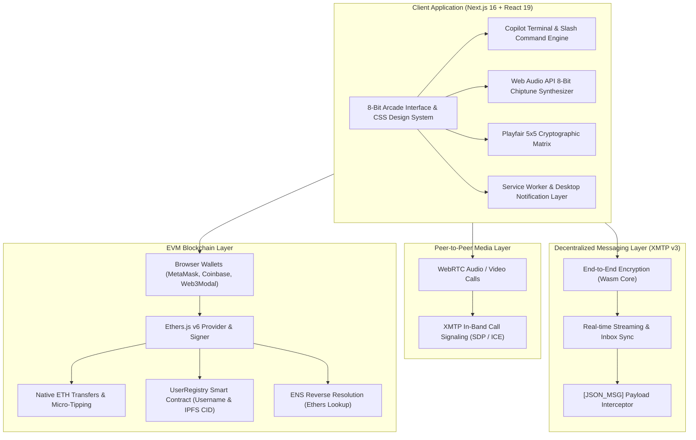

# 👾 BlockChat Arcade (BlockChat 2.0)
### Next-Generation Decentralized Web3 Messenger & Interactive Arcade Hub

> **Live Local Development**: `http://localhost:3000`  
> **Built With**: Next.js 16 (App Router), React 19, XMTP v3, Ethers.js v6, WebRTC, Vanilla CSS & Web Audio API.

---

## 📖 1. Project Overview & Pitch

**BlockChat Arcade** is a decentralized, wallet-to-wallet Web3 communication platform designed for privacy-conscious crypto natives, gamers, and decentralized communities. It marries the familiar, fluid UX of modern messengers (like WhatsApp/Telegram) with the self-custodial ethos of Ethereum, end-to-end cryptographic encryption, and a nostalgic **8-bit retro arcade aesthetic**.

Rather than treating chat as simple text exchange, BlockChat Arcade turns conversations into a **financial and interactive playground**:
- Users chat peer-to-peer with zero central server surveillance via **XMTP v3**.
- Direct micro-tipping, ETH invoice requests, and split bills happen seamlessly in the chat flow.
- Friends can challenge each other to cryptographic duels, seal timelocked capsules, launch live polls, and drop lucky XP packets.
- An arcade sound engine, CRT scanline shader, and customizable retro cabinet themes bring life to every interaction.

---

## 🏛️ 2. High-Level System Architecture



---

## 🕹️ 3. Comprehensive Feature Breakdown

### A. 💬 Decentralized Messaging & Cryptographic Privacy
1. **Wallet-to-Wallet Identity**:
   - Authentication is purely cryptographic—no emails, phone numbers, or passwords.
   - Connect with MetaMask, Coinbase Wallet, Brave Wallet, or any injected EIP-1193 provider.
   - Automatic ENS name reverse lookup (`alice.eth` displays instead of `0x71C...`).
2. **XMTP v3 End-to-End Encryption**:
   - All messages are encrypted with the recipient's public key on device before touching the network.
   - Peer inboxes synchronize across sessions and devices.
3. **Second-Layer "Playfair Cipher" Shoulder-Surfing Shield**:
   - Set a private password/key per chat (🔒 button in chat header).
   - Messages are transformed using a 5×5 Polybius Playfair substitution matrix before being sent.
   - If someone looks over your shoulder or inspects your screen without unlocking, text appears scrambled into retro cipher gibberish.
   - Auto-locks automatically after 3 minutes of inactivity or whenever switching conversations.
4. **Disappearing Messages**:
   - Configure per-chat autodestruct timers (1 Minute, 24 Hours, or 7 Days).
   - Synced via metadata so expired messages fade from the conversation timeline.
5. **Modern Chat Essentials**:
   - Quoted replies (swiping/clicking reply preserves conversational context).
   - In-chat message editing (with an 8-bit `(edited)` indicator).
   - Message revocation & deletion (`🗑️` triggers cryptographic tombstoning).
   - Multi-emoji reactions with real-time reaction counters.
   - In-chat keyword search bar with match counter pills.
   - Pinned chats (`📌`) and starred message bookmarks (`⭐`).

---

### B. 💸 In-Chat Web3 Financial & Utility Tools
1. **Instant ETH Tipping & Micro-Transfers**:
   - Send ETH or testnet funds directly within the chat dialog.
   - Generates an on-screen pixelated **Crypto Receipt Card** complete with formatted transaction hash, network details, and instant block explorer link.
2. **Interactive Crypto Invoicing (Payment Requests)**:
   - Request funds with amount and memo.
   - The recipient sees an interactive invoice card featuring a **"⚡ Pay ETH Now"** button that pre-populates the transaction for one-click signing.
3. **Split Bill / Shared Tabs (`/split`)**:
   - Type `/split 0.3 3 dinner` to automatically calculate per-person shares (0.1 ETH each) and broadcast invoice cards to the squad.
4. **Live Gas Tracker Matrix (`/gas`)**:
   - Queries live EIP-1559 gas prices across **Ethereum Mainnet, Base L2, Sepolia Testnet, and Arbitrum One** with fast/normal recommendations.
5. **Real-Time Crypto Price Feeds (`/price`)**:
   - Instant price and 24-hour delta lookups for tokens (`/price eth`, `/price btc`, `/price sol`, `/price matic`).

---

### C. ⚔️ 8-Bit Arcade Gaming & Social Mechanics
1. **1v1 In-Chat Arcade Duels (`/duel`)**:
   - Challenge any contact or BlockBot to a live **Cypher RPS** (Rock-Paper-Scissors) duel.
   - **Cryptographic Commit-Reveal**: Player 1 locks their move with a hidden salt hash (`keccak256(choice:salt)`); Player 2 defends with their hand; both reveal simultaneously to determine the victor.
   - Real-time combat narrative (*"Rock crushes Scissors! Player 1 Wins! +100 XP"*), victory fanfares, and coin bursts.
2. **Timelocked Vault Capsules (`/capsule`)**:
   - Seal confidential alpha, messages, or promises inside a digital vault with a live ticking countdown (`HH:MM:SS`).
   - Vault presets for rapid demoing (30s, 2m, 10m, 1h, or custom).
   - Once the timer expires, the chest unlocks with an animated shake and fanfare, granting +50 XP and revealing the secret text.
3. **In-Chat Live Polls (`/poll`)**:
   - Spin up live voting cards with `/poll Question | Option A | Option B | Option C`.
   - Dynamic percentage bars animate in 8-bit stepped increments with live ballot counting.
   - Hidden `interaction` packets keep the message list clean while syncing votes.
4. **Lucky XP Gift Packets / Red Envelopes (`/gift`)**:
   - Drop red packets with `/gift [totalXp] [slots]` (e.g., `/gift 100 3`).
   - Uses a deterministic hash distribution algorithm to split XP among the first claimers.
   - Features animated pulse buttons and an on-chain audit roll of winners.
5. **Floating Copilot Terminal Palette**:
   - Type `/` anywhere in the composer to summon a keyboard-navigable command palette with instant autocomplete for all tools (`/flip`, `/roll`, `/gas`, `/price`, `/trivia`, `/duel`, `/capsule`, `/poll`, `/gift`, `/split`, `/export`, `/notify`, `/lobby`).
6. **Gamified XP, Levels & Ranks**:
   - Actions (duels, polls, tips, trivia, ciphers) award Arcade XP.
   - 10 unlockable ranks from **LVL 1 Novice Pixeleer** up to **LVL 10 Sovereign Cypherlord**.
   - Shimmering XP bar, coin particle bursts (`PixelCoinBurst`), and level-up banner toasts.

---

### D. 👾 Multiplayer Arcade Party Lobby & Solo Testing
1. **Multiplayer Arcade Party Lobby (`/lobby` or Alien Header Button)**:
   - A dedicated multi-user lobby featuring simulated retro squad mates:
     - `BlockBot AI 🤖` (Assistant & sparring bot)
     - `CypherPunk #42 🕶️` (DeFi degens & trivia challenger)
     - `PixelKnight 🛡️` (Gamer & poll voter)
   - Color-coded arcade sender tags on received messages (`.peer-knight`, `.peer-cypher`, `.peer-bot`).
   - Group participation: Dropping `/poll` or `/gift` triggers multi-member votes and claims with realistic staggered delays.
2. **Solo Testing Companion (`BlockBot AI`)**:
   - Built-in bot companion (`0x000...dEaD`) enables 100% standalone testing without needing a second device or wallet.
   - Supports simulated two-way text chats, Playfair cipher decryption, voice note feedback, WebRTC call loopback, and duel sparring.

---

### E. 🎨 Visual Design, Cabinet Themes & Sound Studio
1. **Arcade Polish Layer (`arcade-polish.css`)**:
   - Additive styling layer matching pure 8-bit retro gaming culture.
   - Authentic CRT scanlines with dynamic user-controlled density (`Subtle`, `Balanced`, `Rich`).
   - Radial vignette shading, micro-animations (`bubbleIn`), glowing neon borders, and pixelated scrollbars.
2. **6 Curated Arcade Themes**:
   - 🕹️ **Arcade Default**: Neon cyan, hot magenta, gold, and dark purple space.
   - 🟢 **Gameboy Classic**: 4-shade nostalgic olive monochrome.
   - 🌆 **Cyberpunk 2077**: Electric yellow, neon cyan, high-contrast black.
   - ☕ **Espresso Dark**: Cozy dark coffee roast with caramel accents.
   - 🥛 **Cream Latte**: Clean, warm retro parchment light theme.
   - 🍫 **Rich Mocha**: Deep chocolate tones with golden highlights.
3. **Web Audio API Chiptune Sound Studio**:
   - Procedurally generated 8-bit sound effects (no external `.mp3` dependencies):
     - `playSendPop`: Upward arpeggio pop.
     - `playReceiveChime`: Dual-tone melodic bell.
     - `playCoinClink`: High-frequency coin pickup chime.
     - `playDuelFanfare`: Triad victory fanfare.
   - Quick mute toggle in the sidebar header with preference persistence in `localStorage`.

---

### F. 📱 PWA (Progressive Web App) & Desktop Alerts
- **Installable Desktop/Mobile App**: Uses `manifest.webmanifest`, pixel SVG app icon, and a non-caching service worker (`sw.js`).
- **Desktop Push Notifications (`/notify`)**: Native browser alerts notify users of incoming encrypted messages when the tab is backgrounded.
- **Chat Backup & Export (`/export`)**: Download conversation history in human-readable `.txt` or structured `.json` format at any time.

---

## 💻 4. Technology Stack & Key Libraries

| Layer | Technologies Used |
| :--- | :--- |
| **Framework** | [Next.js 16.3.2](https://nextjs.org/) (App Router, Turbopack, React 19) |
| **Styling & FX** | Vanilla CSS3 Variables, CSS Grid/Flexbox, `color-mix()`, CRT Keyframe Shaders |
| **Messaging** | [@xmtp/browser-sdk](https://xmtp.org/) (v3 E2EE decentralized messaging) |
| **Blockchain** | [Ethers.js v6](https://docs.ethers.org/) (Signers, Contracts, Keccak256, ENS) |
| **P2P Audio/Video**| Native WebRTC (`RTCPeerConnection`, `getUserMedia`, STUN fallback) |
| **Audio Engine** | Web Audio API (`AudioContext`, Oscillator nodes, Gain envelopes) |
| **Typography** | Google Fonts (`Press Start 2P`, `Chakra Petch`, `Silkscreen`, `Inter`) |
| **Iconography** | `pixelarticons` + Custom crisp SVG pixel wrappers |

---

## 📁 5. Directory Structure

```text
BlockchainApp/
├── ARCHITECTURE.md             # Deep-dive technical architecture and component specs
├── HANDOVER.md                 # State maps, hooks, and feature implementation checklist
├── PROJECT_OVERVIEW.md         # This comprehensive guide
├── README.md                   # Quickstart instructions
├── web/
│   ├── public/
│   │   ├── icon.svg            # 8-bit crisp pixel art app icon
│   │   ├── manifest.webmanifest# PWA installation manifest
│   │   └── sw.js               # Passthrough service worker & notification listener
│   └── src/
│       ├── app/
│       │   ├── page.js         # Core application hub: state, XMTP, event handlers
│       │   ├── layout.js       # App root, viewport, PWA meta, and CSS cascades
│       │   ├── globals.css     # Base design system & component styles
│       │   ├── arcade-polish.css # CRT scanlines, neon glows, and micro-animations
│       │   ├── features.css    # Polls, gift packets, party lobby & badge styles
│       │   └── contracts.js    # UserRegistry ABI, deployment addresses & helpers
│       ├── components/
│       │   ├── ArcadeDuelCard.js    # 1v1 RPS commit-reveal arena card
│       │   ├── TimeCapsuleCard.js   # Timelocked countdown vault card
│       │   ├── TimeCapsuleModal.js  # Vault creation modal with duration presets
│       │   ├── PollCard.js          # Interactive live poll voting card
│       │   ├── GiftPacketCard.js    # Red envelope lucky XP claim card
│       │   ├── CopilotPalette.js    # Floating '/' slash command dropdown
│       │   ├── CopilotWidgetCard.js # Renderers for coin flips, dice, gas & trivia
│       │   ├── VoiceNotePlayer.js   # Audio visualizer & playback controller
│       │   ├── CryptoReceipt.js     # Transaction receipt with block explorer links
│       │   ├── CallModal.js         # WebRTC voice & video active call modal
│       │   ├── IncomingCallModal.js # Incoming ring & pickup dialog
│       │   ├── PlayfairLockModal.js # Key entry & cipher encryption management
│       │   ├── CoffeeThemeModal.js  # Theme picker & CRT scanline selector
│       │   ├── PixelIcons.js        # Pixel art SVG icon library
│       │   └── PixelCoinBurst.js    # Animated floating coin celebration FX
│       └── utils/
│           ├── copilotEngine.js     # Slash command registry, RNG & trivia data
│           ├── interactions.js      # Poll tallying, gift splits & export logic
│           ├── playfairCipher.js    # 5x5 Polybius cipher matrix engine
│           ├── arcadeXp.js          # XP rank thresholds and level progression
│           ├── soundEffects.js      # Web Audio API 8-bit chiptune sound fx
│           └── whatsappMarkdown.js  # Bold (*), italic (_), strikethrough (~) parser
```

---

## 🚀 6. Getting Started & Local Testing

### Prerequisites
- **Node.js**: v18.17+ or v20+
- **Browser Wallet**: MetaMask, Coinbase Wallet, or Rabby (configured for Sepolia or Ethereum Mainnet).

### Installation & Launch
```bash
# 1. Clone repository & navigate to the frontend directory
cd BlockchainApp/web

# 2. Install dependencies
npm install

# 3. Start development server
npm run dev
```

Visit **`http://localhost:3000`** in Chrome, Brave, or Firefox.

### Quick Testing Checklist
1. **Solo Demo Mode**: Click **"🎮 TRY DEMO MODE (NO WALLET NEEDED)"** on the welcome screen to test with simulated balances and instant bot chats.
2. **Multiplayer Party Lobby**: Click the **Alien Icon (👾)** in the sidebar header or type `/lobby` in chat.
3. **Test Slash Commands**:
   - `/poll Should we deploy to Base? | Yes | No | L2 Rocks`
   - `/gift 100 3`
   - `/duel 0`
   - `/capsule`
   - `/gas`
   - `/price btc`
   - `/flip`
   - `/roll 20`
4. **Secret Cipher**: Click the **Lock Icon (🔒)** in any chat header, set a key (e.g. `arcade`), and exchange encrypted messages.
5. **Theme Switching**: Click the **Gamepad Icon (🎮)** in the sidebar to toggle between all 6 retro arcade themes and customize CRT scanlines.
